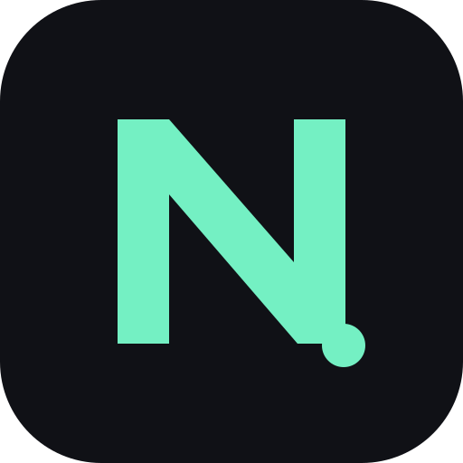
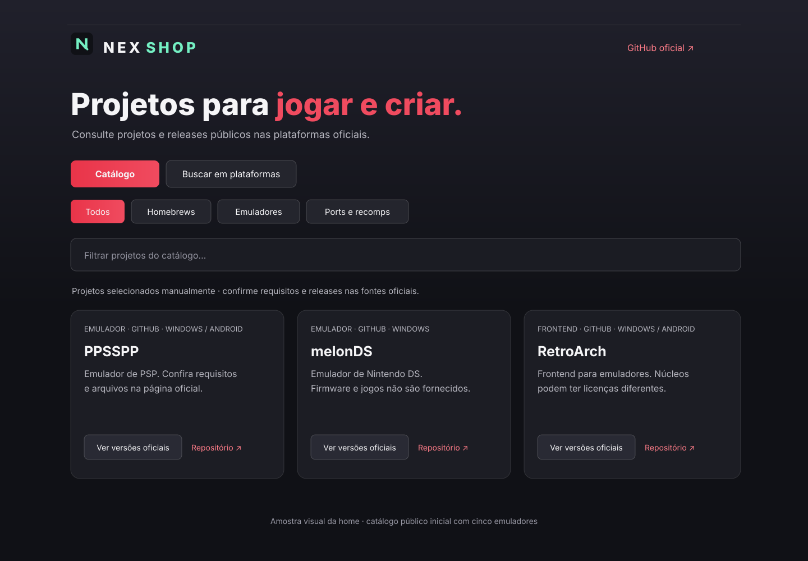

<p align="center">
  
</p>

<h1 align="center">NEX Shop</h1>

<p align="center">Descubra projetos públicos e consulte releases oficiais do GitHub e GitLab.</p>

Loja independente para descobrir projetos de homebrew, emuladores e ports/recomps publicados em repositórios e releases públicos do GitHub e do GitLab. A consulta do catálogo público não exige conta nem token pessoal.

> **Prévia de desenvolvimento.** Esta versão permite pesquisar projetos, consultar informações e abrir as páginas oficiais de releases. Ainda não gerencia downloads nem instalações. Consulte as [limitações](#limitações-conhecidas) antes de usar.

## Amostra da loja



A home reúne o catálogo inicial e atalhos para consultar as versões nas fontes oficiais. A imagem é uma amostra visual da interface; os dados apresentados no app são carregados do catálogo e das APIs públicas.

## Recursos disponíveis

- Pesquisa nas APIs REST públicas oficiais do GitHub e do GitLab.
- Categorias de busca: homebrews, emuladores e ports/recomps.
- Catálogo inicial com cinco emuladores conferidos nos repositórios oficiais em 19/10/2026.
- Inclusão local de repositórios GitHub e GitLab por URL.
- Pesquisa paginada, detalhes do projeto, licença declarada e atividade recente quando informadas pela API.
- Consulta de até dez releases por projeto, notas, indicação de pré-lançamento e links oficiais.
- Cache temporário em memória e mensagens para falhas de rede, projetos ausentes e limites de API.
- Validação de links HTTPS e de caminhos de ativos hospedados na plataforma correspondente.

## Limitações conhecidas

- O catálogo inicial contém cinco emuladores; ainda não há uma seleção curada de homebrews e ports/recomps.
- A busca por termos não valida automaticamente categoria, compatibilidade, licença, segurança ou prontidão do projeto.
- Repositórios adicionados pelo usuário ficam no armazenamento local do navegador e não passam por curadoria da NEX.
- Confira requisitos, licença e origem do projeto antes de baixar. A aplicação abre links oficiais no navegador; não faz o download do arquivo.
- Para GitLab, ativos diretos são exibidos somente quando hospedados em `gitlab.com`; ativos externos não são tratados como downloads compatíveis.
- Ainda não há download gerenciado, retomada/cancelamento, biblioteca instalada, instalação, atualização, reparo ou desinstalação.
- Ainda não há catálogo editável validado, suporte a GitLab self-managed, SteamGridDB, ScreenScraper, preferências de temas/música ou instalação assistida de APK.
- O aplicativo não instala arquivos em silêncio. Não considere um link ou ativo verificado como garantia de segurança.

## Builds de prévia

As releases de prévia podem conter instalador Windows NSIS e APK Android de depuração, conforme os builds aprovados da versão. O instalador Windows não é assinado digitalmente; o APK debug não está assinado para publicação na Play Store. Use somente artefatos anexados à página oficial de [releases](https://github.com/XDavi196/NEX-Shop/releases) e confira as notas de cada versão.

## Desenvolvimento

Requer Node.js 22 ou superior e pnpm 10 ou superior.

```sh
pnpm install --frozen-lockfile
pnpm dev
```

Verificações disponíveis no projeto:

```sh
pnpm test
pnpm build
```

## Build Windows

Requer Rust stable, Visual Studio C++ Build Tools e WebView2 Runtime.

```sh
pnpm install --frozen-lockfile
pnpm tauri build --bundles nsis
```

O instalador NSIS é gerado em `src-tauri/target/release/bundle/nsis/`.

## Build Android

Requer Android Studio/SDK (Platform 35 e Build Tools 35), JDK 21, Node.js e pnpm.

```sh
pnpm install --frozen-lockfile
pnpm build
pnpm exec cap add android
pnpm exec cap sync android
cd android
./gradlew.bat assembleDebug
```

No PowerShell, execute `gradlew.bat assembleDebug`. O APK debug é gerado em `android/app/build/outputs/apk/debug/app-debug.apk`. A instalação de APK depende da confirmação e das configurações do Android.

## Fontes de dados e privacidade

A NEX Shop consulta `https://api.github.com` e `https://gitlab.com/api/v4` sem credenciais. Não solicita senha nem token pessoal e não recebe mensagens ou dados de conta. Links de ativos são validados para HTTPS e para caminhos de release da plataforma correspondente.

O NEX 2 Frontend é um projeto separado e funciona sem a NEX Shop. Consulte o [repositório](https://github.com/XDavi196/NEX-2-Frontend) para os recursos e limites próprios dele.

